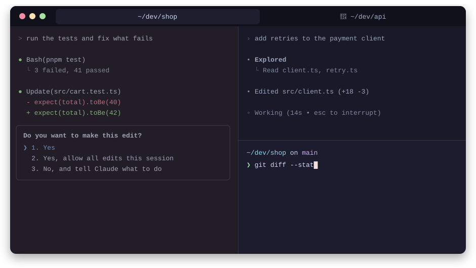

# Blink

**See at a glance which coding agent is waiting for you.**

When Claude Code, Codex CLI or GitHub Copilot CLI needs you (a permission, a
question, a plan to approve, or simply the end of its answer), Blink lights up
that agent's own terminal pane. In Ghostty the whole pane pulses amber while you
work elsewhere, and stops as soon as you type in it.

<p align="center">
  
</p>

- **Nothing to launch.** Open any terminal window and start `claude`, `codex`
  or `copilot` as usual: no wrapper, no alias. Windows that were already open
  work too.
- **Only the waiting pane.** The other panes, including the one you are typing
  in, stay untouched.
- **No idle cost.** 0 % CPU while nothing waits, ~1.4 % while a pane pulses.
- **No dependencies.** Python 3.9+ standard library. No prompt or conversation
  text is ever stored.

> [!NOTE]
> Experimental. Used on macOS with Ghostty 1.3.1, Claude Code and Copilot CLI. Codex CLI and iTerm2 are only covered by automated tests so far.

## Install

```sh
git clone https://github.com/n-pizzetta/blink.git
cd blink
python3 blink.py install
```

Agents that were already running need a restart to load the hooks. **Codex**
asks you to trust new hooks once: run `/hooks` in Codex and approve Blink's.
This is Codex's own review; Blink does not bypass it.

Keep the clone where it is, since the hooks point to it. After moving it, run
`install` again.

```sh
python3 blink.py doctor      # what is installed, which agents are waiting
python3 blink.py uninstall   # remove everything install added
```

<details>
<summary>What <code>install</code> changes</summary>

| Target | Change |
| --- | --- |
| Claude Code | Blink's hooks merged into `~/.claude/settings.json`; your other hooks are kept |
| Codex CLI | Blink's hooks merged into `~/.codex/hooks.json` |
| Copilot CLI | `~/.copilot/hooks/blink.json` |
| Ghostty | A marked block in your Ghostty config: `config-file = ?<clone>/.runtime/ghostty.conf`, then a live reload |

Agents that are not installed are skipped. `CLAUDE_CONFIG_DIR`, `CODEX_HOME`,
`COPILOT_HOME` and `XDG_CONFIG_HOME` are honored. Hooks run with
`/usr/bin/python3` when it is a real interpreter, so they survive `mise` or
`pyenv` upgrades; otherwise with the Python that ran `install`.

If you delete the clone without uninstalling, Ghostty ignores the missing file
and the hooks fail silently; `uninstall` from a fresh clone cleans both up.
</details>

## Terminals

| Terminal | Signal |
| --- | --- |
| Ghostty | The whole pane pulses amber, only while you are not looking at it. A hidden tab is not drawn: it gets the bell, shown as 🔔 in its title with `bell-features = title` |
| iTerm2 | Amber tab color and a "waiting for you" badge on the pane, plus the bell |
| tmux, screen, Terminal.app, WezTerm, kitty, VS Code… | The bell |

Detection uses `TERM_PROGRAM`. SSH sessions are not covered.

## What signals

| CLI | Signals | Never signals |
| --- | --- | --- |
| Claude Code | PermissionRequest, AskUserQuestion, ExitPlanMode, permission and elicitation notifications, Stop | idle_prompt, authentication, subagents |
| Codex CLI | PermissionRequest, request_user_input (when Codex emits PreToolUse for it), Stop | subagents |
| Copilot CLI | notification.permission_prompt, ask_user, notification.elicitation_dialog, agentStop | permissionRequest (fires before auto-approval), agent_idle |

A question asked in the text of an answer is covered by the end of turn: no
keyword matching, no transcript reading. A turn that is still running, for
example waiting for a background agent, signals once it ends.

The signal stops when you type in the pane or send a new prompt, when the
agent resumes work, or when it exits.

## How it works

1. A hook fires and finds the agent as its nearest non-shell parent process,
   then takes that process's terminal (`ps -o tty`). An agent without a
   terminal, such as a headless `claude -p` run by another agent, is ignored.
2. A small watcher process writes the signal to that terminal device. For
   Ghostty it sets palette slot 255 to a marker color (OSC 4) whose last byte is
   the pulse intensity; [`shaders/attention.glsl`](shaders/attention.glsl) tints
   the pane when it sees the marker and the pane is not focused.
3. When the request is over, the watcher resets the palette (OSC 104) and exits.
   Typing is detected through the terminal's input access time, the same value
   `w` uses for idle times: Blink never reads your keystrokes.

Hooks only observe: they never approve, deny, or print anything the agent
reads. State lives in `~/.cache/blink/` and holds session IDs, a pid, a
terminal name and pending request kinds. Sessions whose agent exited, or that a
new session replaced in the same pane, are forgotten.

## Energy

Ghostty's usual way to animate a shader, `custom-shader-animation = always`,
renders every visible pane continuously, even when nothing waits. Measured on
one visible Ghostty 1.3.1 surface (Apple Silicon, `ps` CPU time over 20 s):

| Mode | CPU | Energy impact |
| --- | --- | --- |
| No custom shader | 0 % | 0 |
| A shader with the animation loop (`always`) | 6–7 %, permanently, per visible pane | 12–16 |
| Blink, nothing waiting | 0 % | 0 |
| Blink, one pane pulsing | ~1.4 % | ~1.7 |

Blink sets `custom-shader-animation = false`, so Ghostty only redraws a pane
when its content changes. While a request is pending, the watcher rewrites the
pane's palette ~15 times per second, which redraws that pane alone. Hidden tabs
and windows are not rendered at all. This setting also stops the animation of
any other custom shader you use.

## Limits

- The signal is written to the pane's terminal from outside the agent. A write
  could in theory land in the middle of a large frame the agent is drawing,
  causing a one-frame glitch.
- Palette slot 255 is reserved while a pane pulses. Text drawn with that indexed
  color is recolored meanwhile, then reset to your theme's value.
- iTerm2 tab colors are per tab, not per split; the badge is per pane.
- Only tested on macOS. On Linux the hooks should work; the Ghostty step looks
  for the macOS app (`--app`).
- Blink relies on how each CLI runs its hooks. Verified with Claude Code
  2.1.296, Codex CLI 0.162.0, Copilot CLI 1.0.95 and Ghostty 1.3.1; a later
  version can change that. `doctor` is the first thing to run if a pane stays
  dark.

## Demo without an agent

```sh
python3 blink.py demo
```

Opens a separate Ghostty instance with a temporary configuration (yours is not
touched) and four panes. Session 2 asks for an answer after eight seconds.

- Click the waiting pane: the pulse stops, status "seen".
- `Enter`: answer. `b`: new request in four seconds, then switch pane.
- `p`: pulse right now. `q`: close this demo pane.

If macOS blocks automation, add panes with `Cmd+D` / `Cmd+Shift+D`, or start
with `python3 blink.py demo --single`. From another shell, `python3 blink.py
status`, `wait 2` and `clear 2` drive the last demo.

## Development

```sh
python3 -m unittest discover -s tests -v
```

The tests run the real hooks from a fake agent in a real pseudo-terminal, for
all three CLIs and the three terminal kinds. No model, credentials or network.

References: [Ghostty shaders](https://ghostty.org/docs/config/reference#custom-shader),
[OSC 4 palette](https://ghostty.org/docs/vt/osc/4),
[Claude Code hooks](https://code.claude.com/docs/en/hooks),
[Codex hooks](https://learn.chatgpt.com/docs/hooks),
[Copilot CLI hooks](https://docs.github.com/en/copilot/reference/hooks-reference),
[iTerm2 escape codes](https://iterm2.com/documentation-escape-codes.html).

## License

MIT, see [LICENSE](LICENSE).
